<p align="center">
  
</p>

<p align="center">
  
</p>

<p align="center">
  
  
  
  
  
</p>

> **This repository is a backup snapshot.** Active development lives in [PI-DEV-FRONT](https://github.com/Skander-Bardaoui/PI-DEV-FRONT).

## Overview

A backup snapshot of the NovaEntra ERP frontend (React, TypeScript, Vite). Development continues in the main repository; this copy is kept for reference and rollback.

## Highlights

- Read-only reference snapshot
- Same React, TypeScript and Vite stack as the main frontend
- Active development lives in PI-DEV-FRONT

## Tech stack

<p align="center">
  
</p>

## Getting started

**Prerequisites:** Node.js 20+.

```bash
npm install
npm run dev
```

---

<p align="center">
  
</p>

<p align="center">
  Built by <a href="https://github.com/Skander-Bardaoui"><b>Skander Bardaoui</b></a> ·
  <a href="https://skander-bardaoui.netlify.app/">Portfolio</a> ·
  <a href="https://github.com/Skander-Bardaoui?tab=repositories">All repositories</a>
</p>
